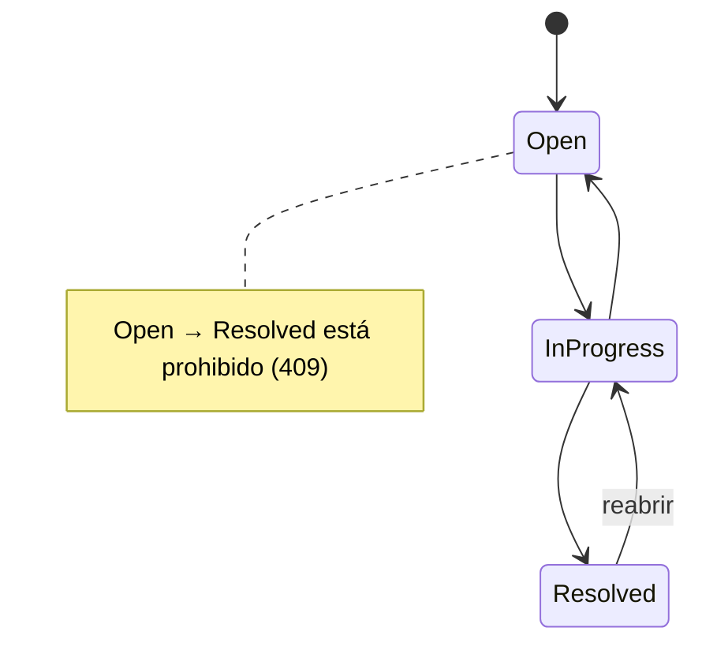
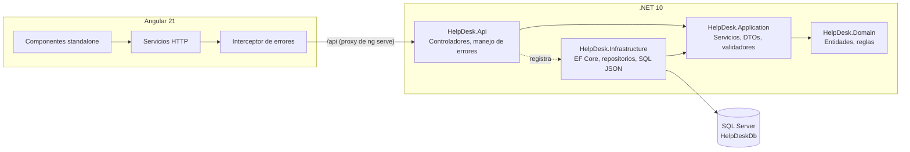
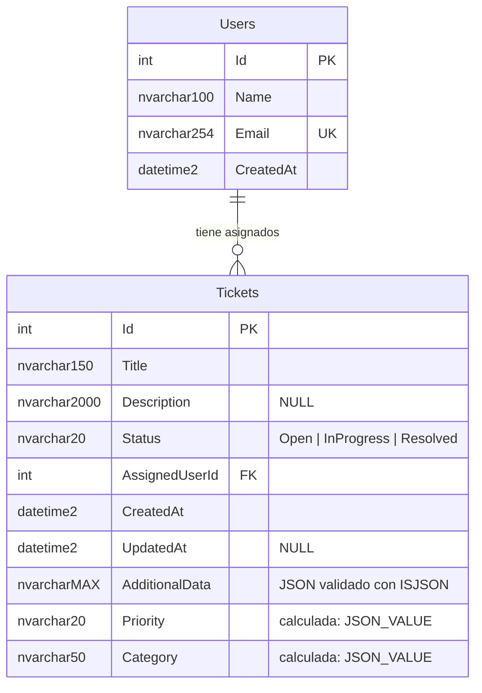

# HelpDesk — Mesa de ayuda

Aplicación de mesa de ayuda para registrar usuarios, crear tickets, asignarlos a
un responsable y hacer seguimiento de su estado. Backend en **.NET 10 Web API**,
frontend en **Angular 21** y base de datos **SQL Server**, con uso de las
funciones JSON nativas de SQL Server (`ISJSON`, `JSON_VALUE`, `JSON_QUERY`,
`OPENJSON` y `JSON_MODIFY`).

## Contenido

1. [Descripción y objetivo](#1-descripción-y-objetivo)
2. [Arquitectura](#2-arquitectura)
3. [Tecnologías](#3-tecnologías)
4. [Estructura de carpetas](#4-estructura-de-carpetas)
5. [Requisitos previos](#5-requisitos-previos)
6. [Base de datos: configuración y scripts](#6-base-de-datos-configuración-y-scripts)
7. [Backend: configuración y ejecución](#7-backend-configuración-y-ejecución)
8. [Frontend: configuración y ejecución](#8-frontend-configuración-y-ejecución)
9. [Ejecución rápida de toda la aplicación](#9-ejecución-rápida-de-toda-la-aplicación)
10. [Endpoints](#10-endpoints)
11. [Ejemplos de solicitudes y respuestas](#11-ejemplos-de-solicitudes-y-respuestas)
12. [JSON en SQL Server](#12-json-en-sql-server)
13. [Decisiones técnicas](#13-decisiones-técnicas)
14. [Pruebas](#14-pruebas)
15. [Funcionalidades implementadas](#15-funcionalidades-implementadas)
16. [Funcionalidades pendientes](#16-funcionalidades-pendientes)

---

## 1. Descripción y objetivo

**Objetivo:** cumplir los requisitos de la prueba técnica de una mesa de ayuda con
una solución funcional, mantenible y defendible:

- **Usuarios:** crear y listar.
- **Tickets:** crear, asignar a un responsable, listar con filtros y cambiar de
  estado (`Open` → `InProgress` → `Resolved`).
- **Reglas de negocio:**
  - el título es obligatorio;
  - todo ticket tiene un usuario asignado (que debe existir);
  - **no se permite pasar de `Open` a `Resolved`** sin pasar por `InProgress`.
- **Información adicional en JSON** (prioridad, categoría, fecha estimada de
  solución, etiquetas y metadatos libres) almacenada en una columna
  `NVARCHAR(MAX)`, validada y consultada con funciones nativas de SQL Server.

Máquina de estados de un ticket:



## 2. Arquitectura

Arquitectura en capas (inspirada en *Clean Architecture*): las dependencias
apuntan hacia el dominio y la lógica de negocio no conoce ni HTTP ni EF Core.



| Proyecto | Responsabilidad |
| --- | --- |
| `HelpDesk.Domain` | Entidades `User` y `Ticket`, enumeraciones y la política de transiciones de estado (`TicketStatusTransitionPolicy`). Sin dependencias externas. |
| `HelpDesk.Application` | Casos de uso (`UserService`, `TicketService`), DTOs, validadores FluentValidation, interfaces de repositorio y excepciones de aplicación. |
| `HelpDesk.Infrastructure` | `HelpDeskDbContext`, configuraciones de EF Core y repositorios, incluidas las consultas con `OPENJSON` y `JSON_MODIFY`. |
| `HelpDesk.Api` | Controladores delgados, manejo centralizado de errores (`ProblemDetails`), OpenAPI/Swagger, CORS y *health check*. |
| `HelpDesk.UnitTests` | Pruebas unitarias del dominio, validadores y servicios. |

**Flujo de una petición:** controlador → servicio (valida con FluentValidation,
aplica reglas) → repositorio (EF Core) → SQL Server. Los errores se lanzan como
excepciones tipadas y `GlobalExceptionHandler` las convierte en respuestas
`ProblemDetails` (400, 404, 409, 500). Los controladores no contienen lógica.

## 3. Tecnologías

| Capa | Tecnología | Versión |
| --- | --- | --- |
| Backend | .NET SDK / ASP.NET Core Web API | 10.0.404 (LTS) |
| ORM | Entity Framework Core (SQL Server) | 10.0.15 |
| Validación | FluentValidation | 12.2.0 |
| Documentación API | OpenAPI nativo + Swashbuckle Swagger UI | 10.0.15 / 11.0.1 |
| Base de datos | SQL Server 2022 Express | 16.x |
| Frontend | Angular (standalone, signals, zoneless) | 21.2 |
| UI | Angular Material (Material 3) | 21.2.14 |
| Runtime frontend | Node.js / npm | 22.14 / 10.9.2 |
| Pruebas backend | xUnit, NSubstitute, FluentValidation.TestHelper | 2.9.3 / 6.2.0 / 12.2.0 |
| Pruebas frontend | Vitest | 4.0.18 |

Las versiones de los paquetes NuGet están centralizadas en
`backend/Directory.Packages.props` y la versión del SDK está fijada en
`global.json`.

## 4. Estructura de carpetas

```text
HelpDesk/
├── global.json                    # Fija el SDK de .NET 10
├── database/
│   ├── 01_schema.sql              # Crea la base de datos, tablas, restricciones e índices
│   ├── 02_seed.sql                # Datos de ejemplo (5 usuarios, 12 tickets)
│   └── 03_queries.sql             # Consultas de demostración (relacionales y JSON)
├── docs/
│   └── TESTING.md                 # Qué prueba cubre cada requisito
├── backend/
│   ├── HelpDesk.sln
│   ├── Directory.Build.props      # Opciones comunes: net10.0, nullable, warnings as errors
│   ├── Directory.Packages.props   # Versiones centralizadas de NuGet
│   ├── src/
│   │   ├── HelpDesk.Domain/          # Entities, Enums, Rules, Exceptions
│   │   ├── HelpDesk.Application/     # DTOs, Interfaces, Services, Validators, Mappings
│   │   ├── HelpDesk.Infrastructure/  # Data (DbContext, Configurations), Repositories
│   │   └── HelpDesk.Api/             # Controllers, Middleware, Program.cs, HelpDesk.Api.http
│   └── tests/
│       └── HelpDesk.UnitTests/       # Domain, Validators, Services, TestDoubles
└── frontend/
    └── helpdesk-web/
        ├── proxy.conf.mjs         # Redirige /api a la API en desarrollo
        └── src/app/
            ├── core/              # Interceptor, modelos de error, notificaciones, i18n
            ├── shared/            # Componentes (badges), validadores y utilidades
            ├── layout/shell/      # Menú lateral y estructura
            └── features/
                ├── tickets/       # Panel de tickets y formulario de creación
                └── users/         # Gestión de usuarios
```

## 5. Requisitos previos

| Herramienta | Versión | Notas |
| --- | --- | --- |
| .NET SDK | 10.0.404 o superior de la línea 10.0.4xx | `dotnet --list-sdks` |
| SQL Server | 2022 (Express o superior) | Probado con la instancia `.\SQLEXPRESS` |
| `sqlcmd` | 15 o superior | Incluido con SQL Server / herramientas de línea de comandos |
| Node.js | 22.14 o superior (22.x LTS) | `node -v` |
| npm | 10.9 | `npm -v` |
| IDE (opcional) | **Visual Studio 2026** o VS Code | **Visual Studio 2022 no compila .NET 10** (necesita MSBuild 18) |

> Si se tienen varios SDK instalados, `global.json` (en la raíz) garantiza que se
> use .NET 10 al ejecutar `dotnet` desde cualquier carpeta del repositorio.

## 6. Base de datos: configuración y scripts

### Configuración de SQL Server

- Instancia: `.\SQLEXPRESS` (cambiarla en los comandos y en la cadena de conexión
  si se usa otra).
- Autenticación de Windows (`-E` en `sqlcmd`, `Trusted_Connection=True` en la API).
- `01_schema.sql` crea la base de datos `HelpDeskDb` si no existe.

### Ejecución de los scripts

Desde la raíz del repositorio, **en este orden**:

```powershell
sqlcmd -S .\SQLEXPRESS -E -C -I -b -f 65001 -i database\01_schema.sql
```

```powershell
sqlcmd -S .\SQLEXPRESS -E -C -I -b -f 65001 -i database\02_seed.sql
```

```powershell
sqlcmd -S .\SQLEXPRESS -E -C -I -f 65001 -i database\03_queries.sql
```

| Opción | Por qué es necesaria |
| --- | --- |
| `-I` | Activa `QUOTED_IDENTIFIER`. Sin ella fallan las operaciones sobre tablas con **índices en columnas calculadas** (las columnas JSON indexadas). |
| `-f 65001` | Lee los scripts como UTF-8; sin ella se corrompen las tildes de los datos de ejemplo. |
| `-C` | Confía en el certificado del servidor (instalaciones locales). |
| `-b` | Detiene la ejecución ante el primer error. |

- `01_schema.sql` **elimina y vuelve a crear las tablas**: borra los datos.
- `02_seed.sql` se puede ejecutar de nuevo para restaurar los datos de ejemplo.
  Los `Id` siguen aumentando en cada recarga (`IDENTITY`).
- `03_queries.sql` no deja cambios: todo lo que escribe lo revierte con
  `ROLLBACK`. Imprime 8 líneas `OK (...)` en las comprobaciones de integridad.

También pueden abrirse en SSMS o Azure Data Studio y ejecutarse con F5.

### Modelo de datos



| Elemento | Detalle |
| --- | --- |
| Claves | `PK_Users`, `PK_Tickets`; `FK_Tickets_Users_AssignedUserId` con `ON DELETE NO ACTION` (no se puede borrar un usuario con tickets). |
| Restricciones | Nombre no vacío y formato de correo; correo único (`UX_Users_Email`); título no vacío; estado dentro de la lista; `UpdatedAt >= CreatedAt`; JSON válido (`ISJSON(..., OBJECT)`); prioridad válida. |
| Índices | `IX_Tickets_AssignedUserId_Status_CreatedAt` (consulta por **usuario + estado + fecha**), `IX_Tickets_Status_CreatedAt`, `IX_Tickets_CreatedAt`, `IX_Tickets_Priority` e `IX_Tickets_Category` (sobre columnas calculadas desde el JSON). |
| Fechas | `DATETIME2(3)` en UTC (`SYSUTCDATETIME()`). |

Consulta por usuario, estado y fecha (bloque A4 de `03_queries.sql`; es la forma
de la consulta que genera `GET /api/tickets`):

```sql
SELECT t.Id, t.Title, t.Status, u.Name AS AssignedUserName, t.CreatedAt,
       COUNT(*) OVER () AS TotalCount
FROM dbo.Tickets AS t
INNER JOIN dbo.Users AS u ON u.Id = t.AssignedUserId
WHERE (@FilterUserId IS NULL OR t.AssignedUserId = @FilterUserId)
  AND (@FilterStatus IS NULL OR t.Status = @FilterStatus)
ORDER BY t.CreatedAt DESC
OFFSET (@PageNumber - 1) * @PageSize ROWS
FETCH NEXT @PageSize ROWS ONLY
OPTION (RECOMPILE);
```

## 7. Backend: configuración y ejecución

### Configuración

La cadena de conexión está en
`backend/src/HelpDesk.Api/appsettings.Development.json`:

```json
"ConnectionStrings": {
  "HelpDeskDb": "Server=.\\SQLEXPRESS;Database=HelpDeskDb;Trusted_Connection=True;TrustServerCertificate=True;Application Name=HelpDesk.Api"
}
```

Para otra instancia o un usuario SQL, cambiarla ahí o, sin tocar el archivo, con
una variable de entorno:

```powershell
$env:ConnectionStrings__HelpDeskDb = "Server=MI_SERVIDOR;Database=HelpDeskDb;User Id=...;Password=...;TrustServerCertificate=True"
```

Los orígenes permitidos por CORS están en `appsettings.json` (`Cors:AllowedOrigins`,
por defecto `http://localhost:4200`). En desarrollo el frontend usa un proxy y no
depende de CORS (ver sección 8).

### Ejecución

**Desde la línea de comandos** (raíz del repositorio):

```powershell
dotnet run --project backend\src\HelpDesk.Api --launch-profile https
```

| Perfil | URL |
| --- | --- |
| `https` | `https://localhost:7080` (y `http://localhost:5080`) |
| `http` | `http://localhost:5080` |

Para el perfil `https` es necesario un certificado de desarrollo
(`dotnet dev-certs https --trust`, una sola vez). El perfil `http` no lo necesita.

**Desde Visual Studio 2026:** abrir `backend\HelpDesk.sln`, elegir el perfil
`https` y arrancar con **Ctrl+F5** (*Iniciar sin depurar*).

> Con **F5** (depurando), Visual Studio se detiene en las excepciones de negocio
> (400/404/409) aunque la API las maneje correctamente. No es un fallo: basta con
> continuar (F5) o arrancar sin depurar.

### Verificación

| URL | Resultado esperado |
| --- | --- |
| `https://localhost:7080/health` | `Healthy` (la API responde y conecta con SQL Server) |
| `https://localhost:7080/swagger` | Swagger UI con todos los endpoints (solo en Development) |
| `https://localhost:7080/openapi/v1.json` | Documento OpenAPI |

`backend/src/HelpDesk.Api/HelpDesk.Api.http` contiene peticiones de ejemplo de
todos los endpoints (casos válidos y de error) para Visual Studio o la extensión
REST Client de VS Code.

## 8. Frontend: configuración y ejecución

```powershell
cd frontend\helpdesk-web
```

```powershell
npm install
```

```powershell
npm start
```

Abrir `http://localhost:4200`.

- **Proxy de desarrollo:** `npm start` (`ng serve`) usa `proxy.conf.mjs`, que
  reenvía `/api` a `https://localhost:7080`. El navegador solo habla con
  `localhost:4200`, así que no hace falta CORS ni confiar en el certificado de
  desarrollo de la API.
- **Otra dirección de API:** si la API corre en otra URL (por ejemplo, el perfil
  `http`), definir `HELPDESK_API_URL` antes de arrancar:

  ```powershell
  $env:HELPDESK_API_URL = "http://localhost:5080"; npm start
  ```

- **Compilación de producción:** `npm run build` (salida en `dist/helpdesk-web/browser`).
  En producción la URL base de la API es `/api`, pensada para servir el frontend
  y la API bajo el mismo dominio (o detrás de un proxy inverso).

### Pantallas

| Ruta | Pantalla |
| --- | --- |
| `/tickets` | Panel: indicadores por estado, filtros (estado, responsable, prioridad, etiqueta, orden), tabla paginada y menú por fila para cambiar estado o prioridad. Solo se ofrecen las transiciones permitidas. |
| `/tickets/new` | Formulario reactivo de creación: título, descripción, responsable, prioridad, categoría, fecha estimada (`dd/mm/aaaa`), etiquetas y departamento. |
| `/users` | Alta de usuarios y listado. |

Los errores de la API se muestran en el campo correspondiente (400), como
notificación (404/409/500) o como estado «sin conexión» con botón *Reintentar*
si la API no está disponible.

## 9. Ejecución rápida de toda la aplicación

```powershell
sqlcmd -S .\SQLEXPRESS -E -C -I -b -f 65001 -i database\01_schema.sql
```

```powershell
sqlcmd -S .\SQLEXPRESS -E -C -I -b -f 65001 -i database\02_seed.sql
```

```powershell
dotnet run --project backend\src\HelpDesk.Api --launch-profile https
```

En otra terminal:

```powershell
cd frontend\helpdesk-web; npm install; npm start
```

Abrir `http://localhost:4200`.

## 10. Endpoints

Base: `https://localhost:7080`. Todas las respuestas de error usan
[`ProblemDetails`](https://www.rfc-editor.org/rfc/rfc9457) (`application/problem+json`).

| Método | Ruta | Descripción | Respuestas |
| --- | --- | --- | --- |
| `POST` | `/api/users` | Crear usuario | 201, 400, 409 (correo duplicado) |
| `GET` | `/api/users` | Listar usuarios (por nombre) | 200 |
| `GET` | `/api/users/{id}` | Obtener usuario | 200, 404 |
| `POST` | `/api/tickets` | Crear ticket (nace en `Open`) | 201, 400 |
| `GET` | `/api/tickets` | Listar con filtros y paginación | 200, 400 |
| `GET` | `/api/tickets/{id}` | Obtener ticket | 200, 404 |
| `PUT` | `/api/tickets/{id}/status` | Cambiar estado | 200, 400, 404, 409 |
| `PATCH` | `/api/tickets/{id}/priority` | Cambiar solo la prioridad (`JSON_MODIFY`) | 200, 400, 404 |
| `GET` | `/api/tickets/summary` | Cantidad de tickets por estado | 200 |
| `GET` | `/api/tickets/tags` | Etiquetas con su número de tickets (`OPENJSON`) | 200 |
| `GET` | `/health` | Estado de la API y de la conexión a SQL Server | 200, 503 |

Parámetros de `GET /api/tickets` (todos opcionales):

| Parámetro | Ejemplo | Filtra / hace |
| --- | --- | --- |
| `status` | `Open`, `InProgress`, `Resolved` | Estado |
| `assignedUserId` | `21` | Responsable |
| `priority` | `Low`, `Medium`, `High`, `Critical` | Valor `$.priority` del JSON |
| `category` | `Network` | Valor `$.category` del JSON |
| `tag` | `vpn` | Etiqueta dentro del arreglo `$.tags` (`OPENJSON`) |
| `sortDirection` | `Descending` (por defecto) / `Ascending` | Orden por fecha de creación |
| `page`, `pageSize` | `1`, `10` (máximo 100) | Paginación |

## 11. Ejemplos de solicitudes y respuestas

Respuestas reales de la API con los datos de `02_seed.sql` (los `id` dependen
de cuántas veces se haya cargado el seed).

### Crear usuario

```http
POST /api/users
Content-Type: application/json

{ "name": "María Gómez", "email": "maria.gomez@example.com" }
```

`201 Created` con cabecera `Location: http://localhost:5080/api/users/26`:

```json
{ "id": 26, "name": "María Gómez", "email": "maria.gomez@example.com", "createdAt": "2026-11-26T10:27:23.397Z" }
```

El mismo correo en mayúsculas (`MARIA.GOMEZ@example.com`) → `409 Conflict`:

```json
{
  "type": "https://tools.ietf.org/html/rfc9110#section-15.5.10",
  "title": "Conflicto con datos existentes",
  "status": 409,
  "detail": "Ya existe un usuario con el correo 'maria.gomez@example.com'.",
  "traceId": "00-bc5fb8118ee4405f19f564306ce1aca0-3b1b778b917f7b19-00"
}
```

### Crear ticket

```http
POST /api/tickets
Content-Type: application/json

{
  "title": "No funciona la impresora de recepción",
  "description": "Muestra el error 'papel atascado' sin papel en la bandeja.",
  "assignedUserId": 21,
  "additionalData": {
    "priority": "High",
    "category": "Hardware",
    "estimatedResolutionDate": "2026-12-15",
    "tags": ["printer", "reception"],
    "metadata": { "department": "Administration", "source": "Phone" }
  }
}
```

`201 Created`. Formato de un ticket (ejemplo real del seed):

```json
{
  "id": 71,
  "title": "Lentitud en la base de datos de reportes",
  "description": "Las consultas del cierre mensual tardan más de 5 minutos.",
  "status": "Open",
  "assignedUserId": 21,
  "assignedUserName": "Ana Torres",
  "createdAt": "2026-11-26T01:06:11.308Z",
  "updatedAt": null,
  "additionalData": {
    "priority": "High",
    "category": "Infrastructure",
    "estimatedResolutionDate": "2026-11-29",
    "tags": ["database", "performance", "server"],
    "metadata": { "department": "IT", "source": "Internal" }
  },
  "allowedTransitions": ["InProgress"]
}
```

`allowedTransitions` indica al frontend qué estados puede ofrecer.

### Validación: ticket sin título ni usuario → `400 Bad Request`

```json
{
  "type": "https://tools.ietf.org/html/rfc9110#section-15.5.1",
  "title": "Uno o más campos no son válidos.",
  "status": 400,
  "errors": {
    "title": ["El título del ticket es obligatorio."],
    "assignedUserId": ["El ticket debe tener un usuario asignado."],
    "additionalData": ["La información adicional (prioridad y categoría) es obligatoria."]
  },
  "traceId": "00-efbea0dd80ef9b24455f708864258720-7ece85aafb98074b-00"
}
```

### Regla de negocio: `Open` → `Resolved` → `409 Conflict`

```http
PUT /api/tickets/71/status
Content-Type: application/json

{ "status": "Resolved" }
```

```json
{
  "type": "https://tools.ietf.org/html/rfc9110#section-15.5.10",
  "title": "Regla de negocio incumplida",
  "status": 409,
  "detail": "No se permite cambiar el estado de 'Open' a 'Resolved'. Desde 'Open' solo se puede pasar a: InProgress.",
  "traceId": "00-c16ca7083a5ac610380c122e2c7a2bb3-9bb645619e02618f-00"
}
```

Con `{ "status": "InProgress" }` responde `200 OK` con el ticket actualizado.

### Recurso inexistente → `404 Not Found`

```json
{
  "type": "https://tools.ietf.org/html/rfc9110#section-15.5.5",
  "title": "Recurso no encontrado",
  "status": 404,
  "detail": "No se encontró el ticket con id '999999'.",
  "traceId": "00-e79554510c2414074e3437bf1fa62a54-7c3c70e3da445cf0-00"
}
```

### Listado paginado y filtros JSON

`GET /api/tickets?status=Open&pageSize=10`:

```json
{ "items": [ { "id": 71, "title": "Lentitud en la base de datos de reportes", "...": "..." } ],
  "page": 1, "pageSize": 10, "totalCount": 5, "totalPages": 1 }
```

`GET /api/tickets?tag=network` devuelve los 3 tickets del seed con esa etiqueta.

`GET /api/tickets/summary`:

```json
{ "total": 12, "open": 5, "inProgress": 4, "resolved": 3 }
```

`GET /api/tickets/tags`:

```json
[ { "tag": "network", "ticketCount": 3 }, { "tag": "server", "ticketCount": 3 }, { "tag": "access", "ticketCount": 1 } ]
```

## 12. JSON en SQL Server

La columna `Tickets.AdditionalData NVARCHAR(MAX)` guarda la información
adicional:

```json
{
  "priority": "High",
  "category": "Network",
  "estimatedResolutionDate": "2026-12-01",
  "tags": ["vpn", "remote"],
  "metadata": { "department": "Sales", "source": "Email" }
}
```

### Qué función se usa, dónde y para qué

| Función | Dónde | Uso |
| --- | --- | --- |
| `ISJSON` | Restricción `CK_Tickets_AdditionalData_IsJson` | `ISJSON(AdditionalData, OBJECT) = 1`: rechaza JSON mal formado y arreglos u otros valores que no sean un objeto. La validación vive en la base de datos, no solo en la API. |
| `JSON_VALUE` | Columnas calculadas `Priority` y `Category` + restricción `CK_Tickets_Priority` | Extrae valores escalares. Las columnas calculadas están **indexadas**, así que filtrar por prioridad o categoría usa un índice en lugar de leer el JSON de cada fila. |
| `OPENJSON` | `GET /api/tickets?tag=` y `GET /api/tickets/tags` | Convierte el arreglo `$.tags` en filas para filtrar (`EXISTS`) y agrupar (`GROUP BY`). |
| `JSON_MODIFY` | `PATCH /api/tickets/{id}/priority` | Cambia solo `$.priority` en el servidor, sin leer ni reescribir el resto del documento. |
| `JSON_QUERY` | `03_queries.sql` (B3, B4.2, B6) | Devuelve objetos y arreglos (`$.tags`, `$.metadata`). La API no la necesita: lee el documento completo y lo deserializa en un DTO tipado. |

### Esquema (`01_schema.sql`)

```sql
AdditionalData NVARCHAR(MAX) NOT NULL
    CONSTRAINT DF_Tickets_AdditionalData DEFAULT (N'{}'),
Priority AS CAST(JSON_VALUE(AdditionalData, N'$.priority') AS NVARCHAR(20)),
Category AS CAST(JSON_VALUE(AdditionalData, N'$.category') AS NVARCHAR(50)),

CONSTRAINT CK_Tickets_AdditionalData_IsJson CHECK (ISJSON(AdditionalData, OBJECT) = 1),
CONSTRAINT CK_Tickets_Priority CHECK (
    JSON_VALUE(AdditionalData, N'$.priority') IS NULL
    OR JSON_VALUE(AdditionalData, N'$.priority') IN (N'Low', N'Medium', N'High', N'Critical'))
-- ...
CREATE INDEX IX_Tickets_Priority ON dbo.Tickets (Priority);
```

`CK_Tickets_Priority` repite la expresión `JSON_VALUE` porque SQL Server no
permite que un `CHECK` referencie una columna calculada no persistida.

### Ejemplos de consulta

```sql
-- ISJSON: validar
SELECT ISJSON(N'{"priority":"High"}') AS ValidObject,   -- 1
       ISJSON(N'{"priority":')        AS Malformed,     -- 0
       ISJSON(N'[1,2]', OBJECT)       AS ArrayAsObject; -- 0

-- JSON_VALUE: leer un campo (incluido uno anidado) y filtrar por él
SELECT Id, Title,
       JSON_VALUE(AdditionalData, N'$.priority')            AS Priority,
       JSON_VALUE(AdditionalData, N'$.metadata.department') AS Department,
       TRY_CAST(JSON_VALUE(AdditionalData, N'$.estimatedResolutionDate') AS DATE) AS EstimatedDate
FROM dbo.Tickets
WHERE JSON_VALUE(AdditionalData, N'$.priority') = N'High';

-- JSON_QUERY: obtener objetos y arreglos (JSON_VALUE devolvería NULL)
SELECT Id, Title,
       JSON_QUERY(AdditionalData, N'$.tags')     AS Tags,
       JSON_QUERY(AdditionalData, N'$.metadata') AS Metadata
FROM dbo.Tickets;

-- OPENJSON: filtrar por un valor del arreglo
SELECT t.Id, t.Title
FROM dbo.Tickets AS t
WHERE EXISTS (SELECT 1 FROM OPENJSON(t.AdditionalData, N'$.tags') AS tag
              WHERE tag.[value] = N'vpn');

-- OPENJSON ... WITH: etiquetas más usadas
SELECT tag.Tag, COUNT(*) AS TicketCount
FROM dbo.Tickets AS t
CROSS APPLY OPENJSON(t.AdditionalData, N'$.tags') WITH (Tag NVARCHAR(30) N'$') AS tag
GROUP BY tag.Tag
ORDER BY TicketCount DESC, tag.Tag;

-- JSON_MODIFY: cambiar solo la prioridad y añadir una etiqueta
UPDATE dbo.Tickets
SET AdditionalData = JSON_MODIFY(
        JSON_MODIFY(AdditionalData, N'$.priority', N'Critical'),
        N'append $.tags', N'escalated'),
    UpdatedAt = SYSUTCDATETIME()
WHERE Id = @TicketId;
```

`database/03_queries.sql` (parte B) contiene estos y más ejemplos, ejecutables
sobre el seed, y las pruebas de que la base de datos rechaza JSON inválido.

### Cómo lo usa el backend

- **Escritura:** el DTO `TicketAdditionalDataDto` se valida (prioridad,
  categoría, fecha, máximo 10 etiquetas, metadatos) y se serializa con
  `System.Text.Json` en *camelCase*. Las etiquetas se normalizan (minúsculas, sin
  duplicados) para que el filtro `tag` sea fiable.
- **Filtros por prioridad y categoría:** EF Core mapea las columnas calculadas
  como solo lectura, así que `Where(t => t.Priority == ...)` genera SQL que usa
  el índice.
- **Filtro por etiqueta:** `FromSql` con `OPENJSON`, parametrizado (sin riesgo de
  inyección) y **componible**: EF Core le añade los demás filtros, el orden y la
  paginación.
- **Cambio de prioridad:** `ExecuteSqlAsync` con `JSON_MODIFY`, en una sola
  sentencia `UPDATE`.

## 13. Decisiones técnicas

| Decisión | Motivo |
| --- | --- |
| **Arquitectura en capas** (Domain / Application / Infrastructure / Api) | Separa reglas de negocio, casos de uso y detalles técnicos; permite probar la lógica sin base de datos. Sin CQRS ni MediatR: no aportan valor a este tamaño de proyecto. |
| **Regla de estados en el dominio** (`TicketStatusTransitionPolicy`) | Una sola fuente de verdad: la usa la entidad para impedir el cambio y la API para devolver `allowedTransitions`, de modo que el frontend no duplica la regla. |
| **Base de datos definida por script** (sin migraciones de EF) | La prueba exige un script de creación. El script es la fuente de verdad (restricciones, columnas calculadas, índices) y EF Core solo lo mapea. |
| **JSON con columnas calculadas indexadas** | Mantiene la flexibilidad del JSON sin renunciar a filtros eficientes en los campos más consultados. |
| **`OPENJSON ... WITH` tipado** | Sin `WITH`, `OPENJSON` devuelve `NVARCHAR(MAX)` y SQL Server reserva mucha más memoria para ordenar o agrupar. Con el tipo explícito, la reserva bajó de ~5,9 MB a ~0,8 MB por consulta. |
| **FluentValidation dentro de los servicios** | La validación forma parte del caso de uso y se prueba con él. Los mensajes están en español y las claves de error coinciden con los campos del formulario. |
| **Manejo centralizado de errores** (`IExceptionHandler` + `ProblemDetails`) | Respuestas de error uniformes y estándar; los controladores no tienen `try/catch`. Los detalles internos de un 500 no se exponen. |
| **400 / 404 / 409** | 400 para datos inválidos (incluido un usuario asignado inexistente, que es un dato de entrada incorrecto); 404 para recursos de la URL inexistentes; 409 para reglas de negocio y correo duplicado. |
| **Usuario inexistente validado en el servicio** + FK en la base de datos | El servicio da un mensaje claro en el campo `assignedUserId`; la FK garantiza la integridad aunque se escriba por otro camino. |
| **Fechas en UTC** con `TimeProvider` | Evita ambigüedades de zona horaria; `TimeProvider` permite pruebas deterministas. |
| **Paginación en el servidor** | El listado no carga todos los tickets; `totalCount` alimenta el paginador. |
| **`PATCH` para la prioridad, `PUT` para el estado** | El estado es el recurso `/status` reemplazado completo (lo pide la prueba); la prioridad es una modificación parcial del JSON. |
| **Angular standalone + signals + zoneless** | Enfoque actual recomendado por Angular: menos código, detección de cambios explícita. |
| **Proxy de desarrollo en lugar de CORS** | El navegador usa un único origen; no hace falta confiar en el certificado de la API. CORS queda configurado para despliegues con dominios distintos. |
| **Interceptor de errores único** | Convierte cualquier error HTTP en `ApiError`; distingue errores de campo, de negocio, del servidor y de conexión, y notifica solo los que el componente no puede manejar. |
| **Presupuesto del bundle inicial: aviso en 650 kB** | Angular Material ocupa la mayor parte. Se redujo de 736 kB a ~603 kB cargando las pantallas de forma diferida y declarando los proveedores (fechas, paginador) en los componentes que los usan. |
| **Vitest fijado en `~4.0.18`** | Las dependencias *peer* de Vitest 4.1 hacen fallar `npm install` con npm 10. |
| **Commits pequeños por fase** | Historial legible (`feat:`, `fix:`, `test:`, `docs:`) que muestra la evolución del proyecto. |

## 14. Pruebas

```powershell
dotnet test backend\HelpDesk.sln
```

```powershell
cd frontend\helpdesk-web; npm test -- --watch=false
```

- **Backend:** 100 pruebas (xUnit + NSubstitute): política de transiciones (las 9
  combinaciones), entidades, validadores y servicios.
- **Frontend:** 40 pruebas (Vitest): interceptor de errores, formulario de
  creación, servicio HTTP, adaptador de fechas y validadores.
- **Base de datos:** `03_queries.sql` comprueba FK, CHECK, UNIQUE y la validación
  JSON.

[docs/TESTING.md](docs/TESTING.md) relaciona cada requisito con la prueba que lo
cubre e incluye las pruebas manuales de integración realizadas.

## 15. Funcionalidades implementadas

**Usuarios**
- [x] Crear usuario (nombre y correo validados; correo único sin distinguir mayúsculas).
- [x] Listar usuarios y obtener uno por id.

**Tickets**
- [x] Crear ticket asignado a un usuario existente; nace en `Open`.
- [x] Título obligatorio y usuario asignado obligatorio.
- [x] Listar con filtros (estado, responsable, prioridad, categoría, etiqueta), orden por fecha y paginación.
- [x] Cambiar estado respetando la máquina de estados; `Open` → `Resolved` devuelve 409.
- [x] Cambiar prioridad con `JSON_MODIFY`.
- [x] Indicadores por estado y catálogo de etiquetas.

**Base de datos**
- [x] Script de creación con PK, FK, restricciones e índices (incluido usuario + estado + fecha).
- [x] Datos de ejemplo y script de consultas de demostración.
- [x] JSON: `NVARCHAR(MAX)`, `ISJSON`, `JSON_VALUE`, `JSON_QUERY`, `OPENJSON` y `JSON_MODIFY`.

**Frontend**
- [x] Listado con filtros, paginación e indicadores.
- [x] Formulario reactivo de creación con selección de usuario y validaciones.
- [x] Cambio de estado (solo transiciones permitidas) y de prioridad.
- [x] Gestión de usuarios.
- [x] Manejo de errores: por campo, notificaciones y estado sin conexión con reintento.
- [x] Diseño adaptable (escritorio y móvil) e interfaz en español.

**Calidad**
- [x] Swagger/OpenAPI, *health check*, pruebas unitarias en backend y frontend.

## 16. Funcionalidades pendientes

Fuera del alcance de la prueba; serían los siguientes pasos en un proyecto real:

| Pendiente | Motivo / propuesta |
| --- | --- |
| Autenticación y autorización | No se pidió. Se añadiría JWT (o Microsoft Entra ID) y roles (agente, administrador). |
| Control de concurrencia optimista | Hoy, si dos personas cambian el mismo ticket, gana la última escritura (la regla de estados sí se valida en cada cambio). Se añadiría una columna `rowversion` y se devolvería 409 si el ticket cambió. |
| Reasignar, editar y eliminar tickets; editar y eliminar usuarios | No los pide la prueba. La FK `NO ACTION` ya impide borrar usuarios con tickets. |
| Historial de cambios de estado | Una tabla `TicketStatusHistory` para auditoría. |
| Pruebas de integración y *end-to-end* | Pruebas de la API contra SQL Server real (`WebApplicationFactory` + base de datos de pruebas) y pruebas E2E del frontend (Playwright). |
| Contenedores y CI | `docker-compose` (SQL Server + API + frontend) y un *pipeline* que ejecute compilación y pruebas en cada *push*. |
| Despliegue | Configuración de producción (cadena de conexión en secretos, CORS con el dominio real, servir el frontend detrás del mismo dominio). |
